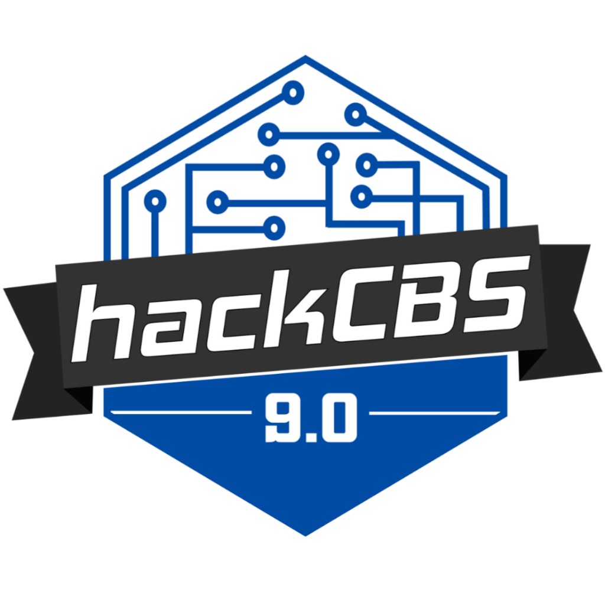
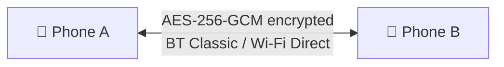
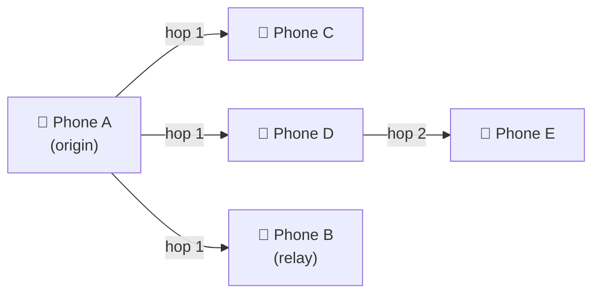
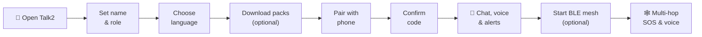
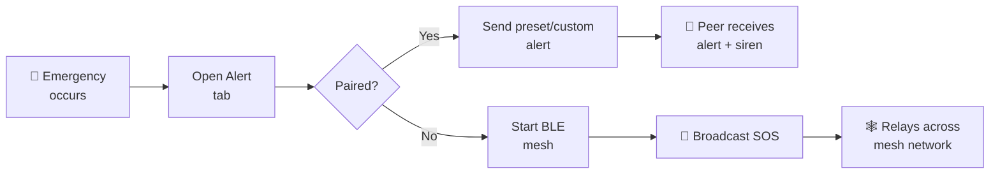
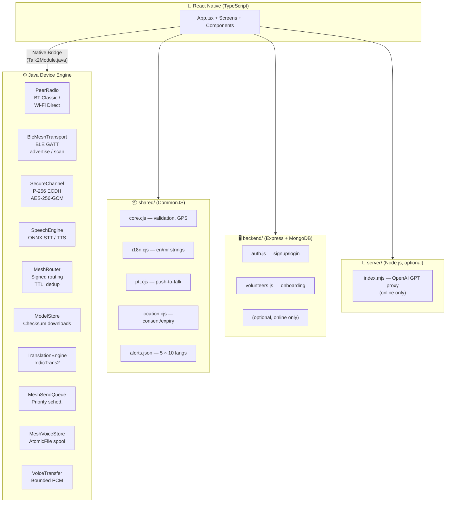
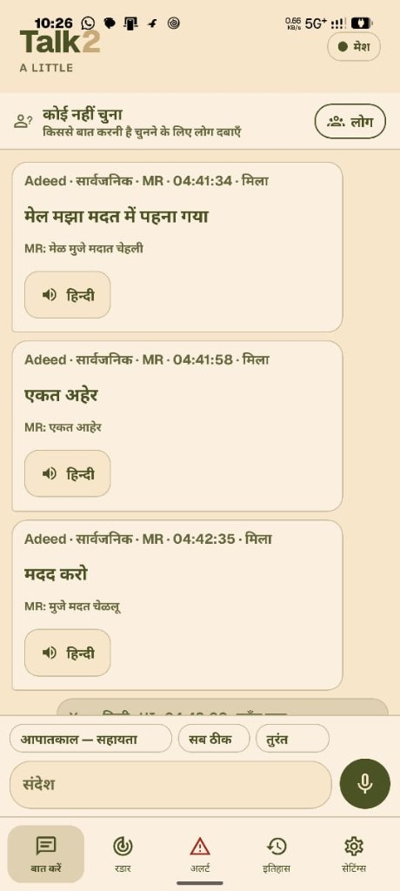
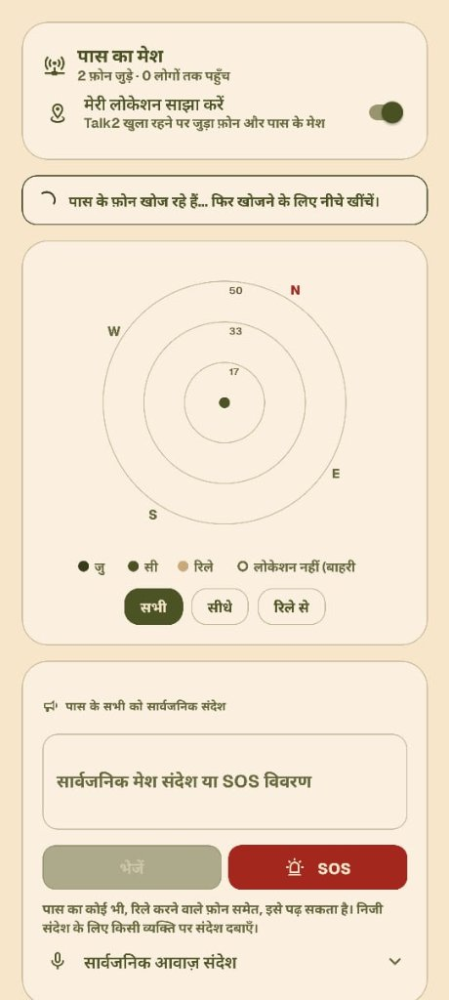
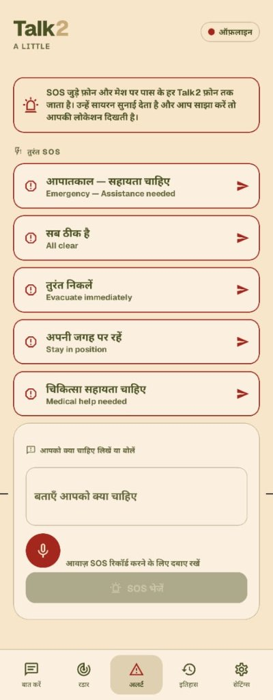
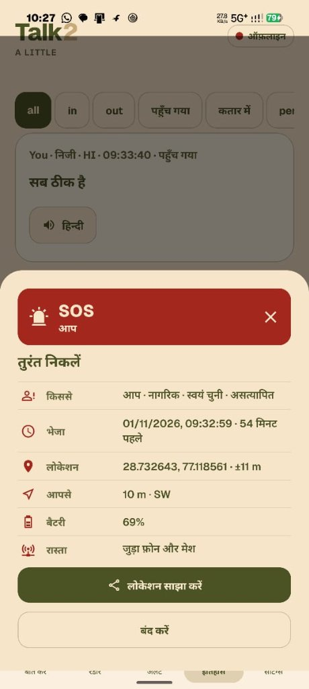

<!-- ───────────────────────────────────────────────── -->
<!--  Talk2 — HackCBS 9.0 Project                    -->
<!-- ───────────────────────────────────────────────── -->

<p align="center">
  
</p>

<h1 align="center">🗣️ Talk2</h1>

<p align="center">
  <strong>Your voice. Your community. Without internet.</strong>
</p>

<p align="center">
  Offline peer-to-peer communication, BLE mesh relay, multilingual speech, and emergency SOS.
</p>

<p align="center">
  <a href="https://hackcbs.tech/#about">
    
  </a>
</p>

<p align="center">
  
  
  
</p>

<p align="center">
  <a href="mobile/"></a>
  <a href="mobile/android/app/src/main/java/com/talk2/"></a>
  <a href="mobile/android/app/src/main/java/com/talk2/BleMeshTransport.java"></a>
  <a href="backend/"></a>
  <a href="server/"></a>
</p>

---

> **Your voice. Your community. Without internet.** Talk2 turns two phones into a secure
> communication channel — and three or more into a mesh network — so communities can
> coordinate when infrastructure fails.

Talk2 is an **Android peer-to-peer communication app** built for disaster response and
community coordination at **[HackCBS 9.0](https://hackcbs.tech/#about)** — India's largest
student-run hackathon. Two phones pair over Bluetooth Classic or Wi-Fi Direct with
end-to-end encryption. Beyond the direct pair, a BLE mesh relays text, SOS alerts, and
short voice notes across multiple hops — all without any server or internet connection.
Ten Indian languages are supported for speech recognition, translation, and
text-to-speech, running fully on-device through ONNX models.

---

## ⚡ At a Glance

| 🔒 Direct Communication | 🕸️ Mesh Networking | 🌐 Multilingual Intelligence | 🚨 Emergency Response |
| --- | --- | --- | --- |
| Encrypted BT/Wi-Fi Direct pairing, text chat, voice messages, and push-to-talk | BLE GATT multi-hop relay, signed routing, store-and-forward, neighbor management | 10-language ONNX speech packs, CTC recognition, VITS synthesis, IndicTrans2 translation | SOS broadcast with priority routing, preset alerts in 10 languages, GPS radar, responder roles |

**Core principle:** communication should work when everything else doesn't — no internet, no server, no infrastructure.

---

## 📑 Contents

- [Why It Matters](#-why-it-matters)
- [What It Does](#-what-it-does)
- [Communication Modes](#-communication-modes)
- [Emergency Features](#-emergency-features)
- [User Journey](#-user-journey)
- [System Architecture](#-system-architecture)
- [Speech Pipeline](#-speech-pipeline)
- [Product Surfaces](#-product-surfaces)
- [Repository Structure](#-repository-structure)
- [Technology Stack](#-technology-stack)
- [Run Locally](#-run-locally)
- [Two-Phone Test](#-two-phone-test)
- [Models](#-models)
- [Documentation](#-documentation)
- [Safety and Limitations](#-safety-and-limitations)

---

## 💡 Why It Matters

When disasters strike, cell towers go down, internet stops, and centralized communication
fails. First responders and communities need a way to coordinate with nothing but the
phones in their pockets.

| ❌ Without Talk2 | ✅ With Talk2 |
| --- | --- |
| No communication when cell towers fail | Direct Bluetooth/Wi-Fi pairing — zero infrastructure needed |
| Messages can't reach beyond line-of-sight | BLE mesh relays across multiple hops (A → B → C) |
| Language barriers in multilingual communities | 10-language speech recognition, translation, and synthesis |
| No way to broadcast emergency alerts | Priority SOS broadcast with signed origin and multi-hop relay |
| Unverified responder identity claims | Cryptographic device identity with role framework |
| No situational awareness of nearby people | GPS radar with compass bearing, distance, and peer discovery |
| Voice messages require internet services | Original voice and mesh voice notes — fully offline |
| Shared data readable by intermediaries | End-to-end AES-256-GCM on direct links; signed mesh packets |

---

## 🛠️ What It Does

- 🔐 **Encrypted direct pairing** — P-256 ECDH key exchange, HKDF-SHA256 derivation, directional AES-256-GCM encryption, and operator-confirmed six-digit pairing code.
- 💬 **Text and voice chat** — real-time text messaging, push-to-talk with 20-second capture, original voice transfer with SHA-256 integrity, and auto-playback.
- 🕸️ **BLE mesh relay** — signed packet routing across up to four hops, three-neighbor management, store-and-forward queue, duplicate suppression, and custody receipts.
- 🎙️ **Mesh voice notes** — 3-second public voice notes relayed through BLE mesh with optional source transcription and receiver-side translation/TTS.
- 🚨 **SOS broadcast** — priority-routed emergency alerts that preempt normal traffic, with preset phrases in all ten languages.
- 🌐 **Multilingual speech** — on-device ONNX speech recognition (IndicWav2Vec), text-to-speech (MMS-VITS), and translation (IndicTrans2) for 10 Indian languages.
- 📡 **GPS radar** — compass-relative peer bearing, Haversine distance, consent-based location sharing, anonymous radar dots, and 20 m proximity siren.
- 🏷️ **Responder roles** — citizen, volunteer, medical/support, and emergency staff with honest unverified display; future credential verification [documented](docs/VERIFICATION_API.md).
- 👥 **Volunteer backend** — optional Express/MongoDB API for signup, JWT login, role-based onboarding, and responder roster management.

---

## 📡 Communication Modes

Talk2 supports two independent communication paths that operate simultaneously:

### 🔒 Mode 1 — Direct Encrypted Pair



- One authenticated session at a time
- Full text, voice (up to 20s), translated speech, alerts, and GPS sharing
- End-to-end encrypted with replay protection and nonce counters
- Pairing requires physical confirmation of a six-digit code on both phones

### 🕸️ Mode 2 — BLE Mesh Relay (Multi-Hop)



- Public broadcast with origin P-256 signatures
- Text, SOS, and short voice notes relay across up to **4 hops**
- TTL decrement, 24-hour expiry, duplicate suppression, and priority scheduling
- Bodies are readable by relays — do not send private data through mesh

---

## 🚨 Emergency Features

- 🔴 **Priority SOS routing** — SOS packets preempt queued bulk traffic, ensuring emergency alerts propagate first.
- 🗣️ **Preset emergency alerts** — five phrases in all 10 languages, one-tap send:
  - *"Emergency — Assistance needed"*
  - *"Evacuate immediately"*
  - *"Medical help needed"*
  - *"Stay in position"*
  - *"All clear"*
- ✏️ **Custom alerts** — up to 200-character custom emergency messages with confirmation.
- 🎙️ **Mesh voice SOS** — 3-second voice notes with SOS priority through BLE mesh.
- 🏷️ **Responder identification** — self-declared roles (citizen, volunteer, medical/support, emergency staff) with honest "Unverified" label.
- 📡 **GPS radar** — real-time compass bearing and Haversine distance to peers, consent-based sharing, 30-second expiry.
- 🔔 **Proximity siren** — optional audible alert when a peer enters 20 m GPS range.
- ✈️ **Fully offline** — all emergency features work without internet, cell service, or any server.

---

## 🗺️ User Journey

### Normal Flow



### Emergency Path



---

## 🏗️ System Architecture



The mobile app owns **all** peer communication, speech processing, and sensor data. The
Java engine handles radios, ONNX inference, cryptography, and mesh routing. The backend
and server are optional online services — **Talk2 is fully functional without them.**

---

## 🧠 Speech Pipeline

The speech layer is **fully on-device**. No audio, text, or location data leaves the phone.

| Capability | Implementation |
| --- | --- |
| 🎤 Speech recognition | IndicWav2Vec CTC models, 16 kHz PCM16, per-language INT8 ONNX |
| 🔊 Text-to-speech | MMS-VITS single-input models, per-language INT8 ONNX |
| 🔄 Translation | IndicTrans2 encoder-decoder, BPE tokenization, Hindi ↔ Marathi validated |
| 📤 Voice transfer | 16 kHz mono PCM, SHA-256 integrity, bounded chunks, encrypted on direct links |
| 📡 Mesh voice | 3-second public broadcast, origin-signed, relay-readable, optional transcript |
| 📦 Model management | Checksum-verified downloads, HTTP Range resume, atomic ready markers |
| 🌏 Languages | Hindi, Tamil, Bengali, Gujarati, Marathi, Kannada, Malayalam, Telugu, Odia, English |

> **Note:** Text and original voice communication work without downloading any speech packs.
> On-device translation currently supports Hindi ↔ Marathi.

---

## 📱 Product Surfaces

### 1. Talk2 Mobile App

The mobile app combines onboarding, encrypted direct chat, BLE mesh relay, multilingual
speech, GPS radar, emergency alerts, and model management in a single offline-first experience.

<table>
  <tr>
    <td align="center">
      
      <br><sub><b>Talk & Speech</b><br>Chat, PTT voice & on-device translation</sub>
    </td>
    <td align="center">
      
      <br><sub><b>Radar & Mesh</b><br>Compass bearing, distance & BLE peers</sub>
    </td>
    <td align="center">
      
      <br><sub><b>Emergency Alerts</b><br>10-language presets & voice SOS</sub>
    </td>
    <td align="center">
      
      <br><sub><b>Live SOS Dispatch</b><br>Real-time GPS, azimuth & relay path</sub>
    </td>
  </tr>
</table>

Five primary tabs organize the workflow:

| Tab | Purpose |
| --- | --- |
| 💬 **Talk** | Text chat, push-to-talk voice, message history, and quick alert phrases |
| 📡 **Radar** | GPS compass radar, peer discovery, BLE mesh controls, and distance/bearing |
| 🚨 **Alert** | Preset and custom emergency alerts with one-tap send |
| 📜 **History** | Message log with filter by direction, status, and delivery state |
| ⚙️ **Settings** | Profile, role, language (UI/speech/translation/TTS), appearance, privacy, models |

### 2. Volunteer Backend (optional)

Express/MongoDB API for accounts, JWT authentication, role-based volunteer onboarding,
and responder roster queries — for online coordination scenarios.

### 3. GPT Assistant (optional)

Node.js server proxying explicit user questions to OpenAI. Radio messages and GPS are
never sent automatically. Requires internet and API credentials.

---

## 📂 Repository Structure

```
Talk2/
├── mobile/                       # React Native app + Android Java engine
│   ├── App.tsx                   # Main UI, state, and event handling
│   ├── src/                      # TypeScript modules and components
│   │   ├── native.ts             #   Native bridge (direct + mesh APIs)
│   │   ├── MeshVoicePanel.tsx    #   Mesh voice note UI
│   │   ├── RadarPeers.tsx        #   Radar peer list component
│   │   └── TranslatedVoice.tsx   #   Translation/TTS action UI
│   └── android/                  # Gradle project and Java source
│       └── app/src/main/java/com/talk2/
│           ├── PeerRadio.java           # BT Classic / Wi-Fi Direct
│           ├── BleMeshTransport.java    # BLE GATT advertiser/scanner
│           ├── MeshRouter.java          # Signed packet routing + dedup
│           ├── MeshPacket.java          # Versioned mesh envelope
│           ├── MeshVoiceStore.java      # Voice note spool + relay
│           ├── MeshSendQueue.java       # Priority scheduling
│           ├── SecureChannel.java       # P-256 ECDH, AES-256-GCM
│           ├── SpeechEngine.java        # ONNX STT and TTS
│           ├── TranslationEngine.java   # IndicTrans2 inference
│           ├── ModelStore.java          # Checksum-verified model downloads
│           ├── VoiceTransfer.java       # Bounded PCM transfer
│           └── ProfilePhoto.java        # Local photo picker
│
├── shared/                       # Protocol validation, i18n, policies
│   ├── core.cjs                  # Message validation, GPS math
│   ├── i18n.cjs                  # English + Marathi UI (270 keys)
│   ├── i18n-indic.cjs            # Extended Indic language strings
│   ├── alerts.json               # 5 emergency presets × 10 languages
│   ├── ptt.cjs                   # Push-to-talk state machine
│   ├── location.cjs              # Consent, expiry, accuracy rules
│   └── language-state.cjs        # Independent language setting policy
│
├── backend/                      # Express API, MongoDB, JWT, volunteer routes
├── server/                       # Optional Node.js GPT assistant proxy
├── model-host/                   # Pinned model manifest (39 assets, SHA-256)
├── scripts/                      # Model export, manifest gen, Java tests
├── tests/                        # Node.js + Java test suites
└── docs/                         # Architecture, build, device tests, status
```

---

## 🔧 Technology Stack

| Layer | Technology |
| --- | --- |
| 📱 Mobile UI | React Native 0.76, TypeScript, React Hooks |
| ⚙️ Device engine | Java, Android SDK 35, ONNX Runtime |
| 📶 Direct transport | Bluetooth Classic RFCOMM, Wi-Fi Direct TCP |
| 🔗 Mesh transport | BLE GATT central/peripheral, ATT MTU-aware fragmentation |
| 🔐 Cryptography | P-256 ECDH, HKDF-SHA256, AES-256-GCM, Android Keystore P-256 |
| 🧠 Speech models | IndicWav2Vec (STT), MMS-VITS (TTS), IndicTrans2 (translation) |
| 🖥️ Backend | Node.js, Express, MongoDB, Mongoose, JWT, bcrypt |
| 🤖 Assistant | Node.js, OpenAI Responses API |
| 🏗️ Build | Gradle 8.13, Build Tools 35.0.0, NDK 26.1.10909125 |
| 🧪 Testing | Node.js test runner, 7 JVM harness groups |

---

## 🚀 Run Locally

### Prerequisites

- **Node.js 22+** and **JDK 17**
- **Android Studio** with SDK 35, Build Tools 35.0.0, NDK 26.1.10909125
- **Two Android phones** for testing
- MongoDB (optional, for volunteer backend)

### Start the mobile app

**Terminal 1 — Metro bundler:**

```powershell
npm ci
npm start
```

**Terminal 2 — install on phone:**

```powershell
adb devices
adb reverse tcp:8081 tcp:8081
cd mobile\android
.\gradlew.bat :app:installDebug
```

Open **Talk2 Dev** on the phone (`com.talk2.dev`). Keep Metro running for Fast Refresh.

### Start the volunteer backend (optional)

```bash
cd backend
npm install
cp .env.example .env     # set JWT_SECRET and MONGODB_URI
npm run dev              # nodemon, port 5000
```

### Start the GPT assistant (optional)

```bash
cd server
cp .env.example .env     # set TALK2_ACCESS_TOKEN, OPENAI_API_KEY, OPENAI_MODEL
node --env-file-if-exists=.env index.mjs
```

### Run tests

```powershell
npm test                 # 21 Node.js tests
npm run check            # tests + TypeScript typecheck
```

```powershell
# Java tests — security, models, voice, mesh (7 harness groups)
powershell -ExecutionPolicy Bypass -File scripts/test-java.ps1
```

---

## 📲 Two-Phone Test

Install the same version on both phones. Host on one, join from the other, and confirm
the matching six-digit code.

| Step | Test | What to check |
| --- | --- | --- |
| 1 | **Text** | Send text both ways → delivered status in history |
| 2 | **Original voice** | Hold → speak → release → auto-play and history replay |
| 3 | **Translated speech** | Download speech pack → speak → check recognized text + receiver synthesis |
| 4 | **Radar** | Enable GPS sharing outdoors → verify distance, bearing, siren at 20 m |
| 5 | **BLE mesh** | Grant BT permissions → start mesh → send public text and SOS |
| 6 | **Three-phone relay** | A and C out of range, B between → verify relay delivery |

See [DEVICE_TESTS.md](docs/DEVICE_TESTS.md) for the complete 20-card acceptance checklist.

---

## 📦 Models

Talk2 uses on-device ONNX models for speech recognition, synthesis, and translation.
The app includes a built-in pinned manifest (`model-host/upstream-manifest.json`) specifying
the exact filenames, byte sizes, and SHA-256 integrity digests for all 39 model assets.

- **Zero-setup communication:** Text chat, original voice messages (16 kHz PCM), alerts, and mesh relay work immediately **without downloading any model packs**.
- **Speech pack management:** Download and verify optional language packs directly within the app settings.
- **Custom hosting:** You can host model assets on your own server or GitHub release by configuring the manifest URL in settings.

See [MODEL_HOSTING.md](docs/MODEL_HOSTING.md) for export scripts, model architectures, and hosting instructions.

---

## 📚 Documentation

| Document | Description |
| --- | --- |
| [Architecture](docs/ARCHITECTURE.md) | System design, radio protocols, mesh envelope, voice pipeline |
| [Build](docs/BUILD.md) | Signing, Gradle config, troubleshooting, APK output |
| [Status](docs/STATUS.md) | Implementation status, verified behavior, current boundaries |
| [Device Tests](docs/DEVICE_TESTS.md) | 20-card two-phone and three-phone acceptance checklist |
| [Model Hosting](docs/MODEL_HOSTING.md) | Model matrix, SHA-256 verification, evidence |
| [Verification API](docs/VERIFICATION_API.md) | Future signed credential and responder verification |
| [Work Checkpoint](docs/WORK_CHECKPOINT.md) | Stage-by-stage implementation history and commits |
| [Backend README](backend/README.md) | Volunteer API setup and route reference |

---

## ⚠️ Safety and Limitations

Talk2 is a communication tool for disaster coordination. It does **not** contact emergency
services (112/108/100) automatically. SOS alerts reach only paired phones and mesh peers.

- 🔓 Mesh message bodies are **public** — readable by every relay. Do not send private information.
- 🔑 Mesh signatures bind a **device key**, not a verified person or organization.
- 📍 GPS accuracy is approximate and unavailable indoors. The 20 m siren is not a safety detector.
- 🗣️ General on-device model translation currently supports Hindi ↔ Marathi.
- 📲 The app must stay in the foreground — no foreground service for background mesh.
- 🧪 Physical two-phone and three-phone acceptance testing is required before deployment.

---

## 📄 Licence

See [LICENSE](LICENSE) and [NOTICE](NOTICE). Model and source licenses are separate.
The NOTICE identifies included runtime and model families whose own terms must be
reviewed before distribution.

---

<p align="center">
  <a href="https://hackcbs.tech/#about">
    
  </a><br>
  Built with ❤️ at <a href="https://hackcbs.tech/#about"><strong>hackCBS 9.0</strong></a> — India's Largest Student-run Hackathon
</p>
